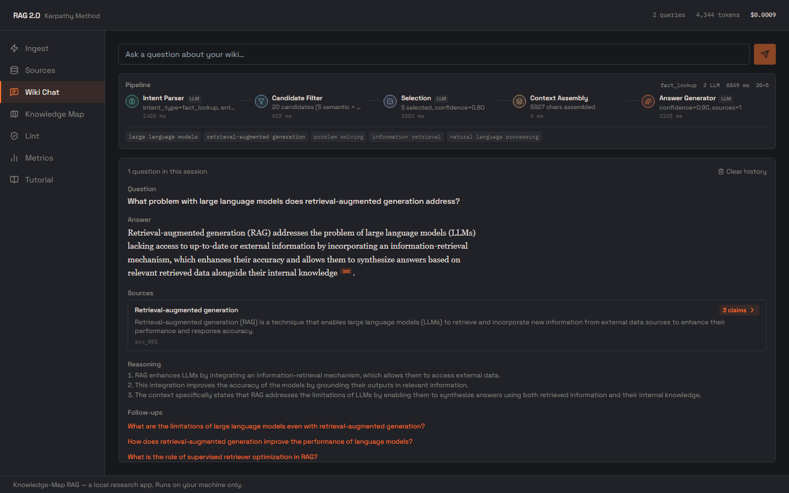
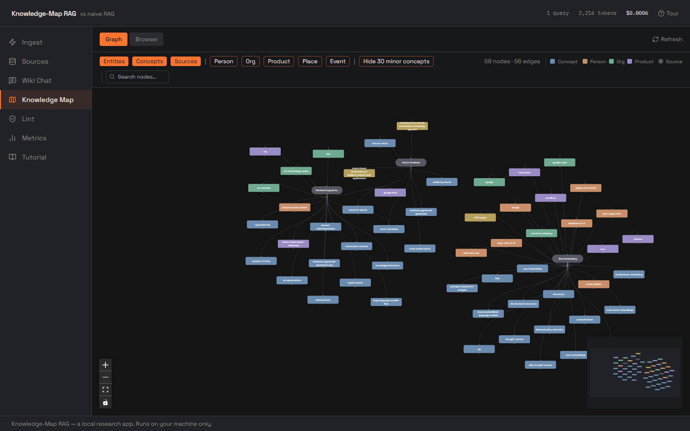
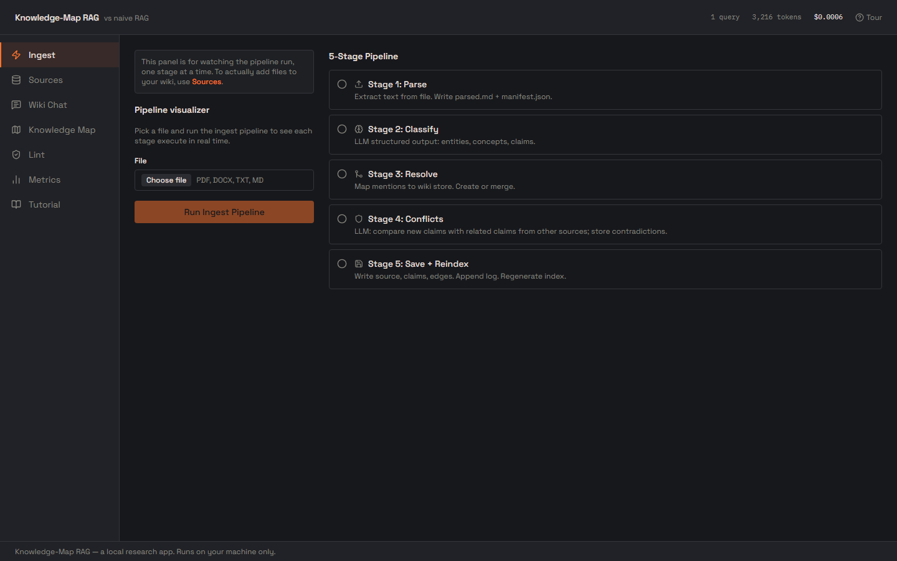
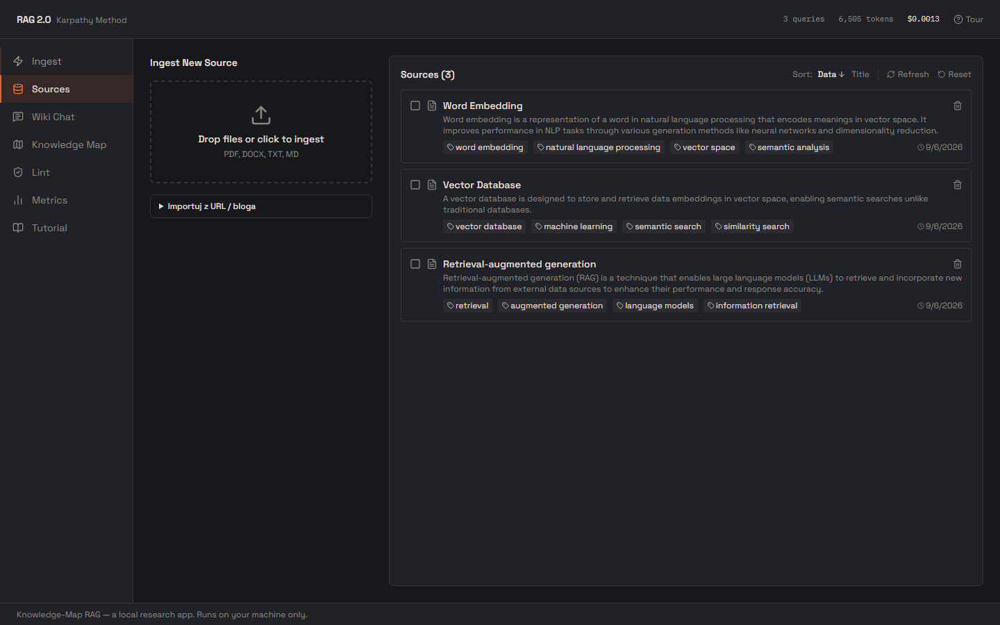
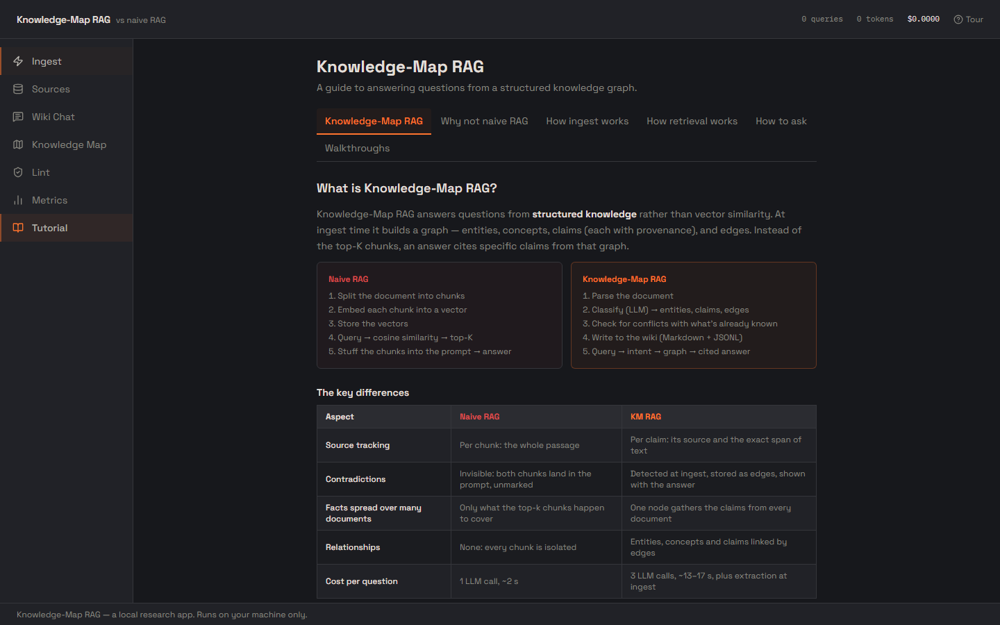
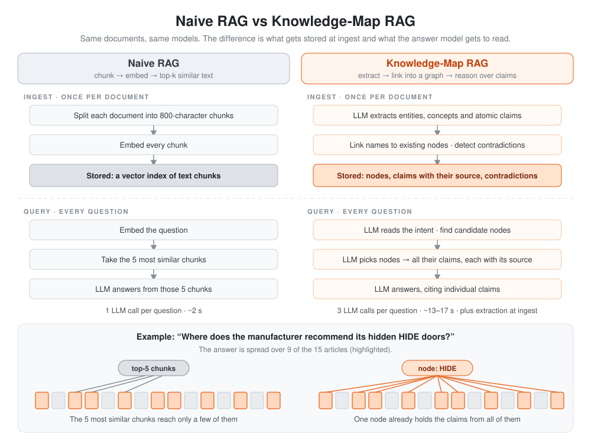

# Knowledge-Map RAG vs Naive RAG

*English · [Polski](README.pl.md)*

[](https://github.com/KonP969/knowledge-map-vs-naive-rag/actions/workflows/ci.yml)

A local, educational web app that implements **Knowledge-Map RAG** — an experiment
inspired by Andrej Karpathy's critique of naive retrieval-augmented generation.
Instead of searching raw text chunks, the system extracts a structured knowledge
graph from every source at ingest time — entities, concepts and atomic claims — and
answers questions by searching and reasoning over that graph, showing its work at
every step.

This is a research/learning project: the point is to make the retrieval pipeline
legible, not to be a production RAG stack.



Ask a question and the pipeline runs across the top, one stage at a time; the
answer below cites the exact claims it used.

| | |
|---|---|
| [](docs/screenshots/knowledge-map.png) | [](docs/screenshots/ingest.png) |
| The graph your answers are built from | The 5-stage ingest pipeline, per source |
| [](docs/screenshots/sources.png) | [](docs/screenshots/tutorial.png) |
| Every ingested source and what was extracted | An in-app guide to the whole approach |

On the first visit a short tour walks you through the panels — replay it any time
from the **Tour** button in the header.

## Why not naive RAG?

Classic RAG (chunk → embed → vector search → stuff context → LLM) struggles with:

- **Conflicting facts** — two sources disagree; the model gets both and blends them
- **Multi-hop questions** — the answer needs facts connected across several documents
- **Temporal updates** — a newer source contradicts an older one, but the old chunk wins on similarity score

Knowledge-Map RAG extracts structure at ingest time — entities, concepts, claims
(each with provenance), and edges — then retrieves through a 5-stage reasoning
pipeline. Every sentence in an answer traces back to a specific claim.



Those are the hypotheses. The next section is what they look like when measured.

## Does it beat naive RAG? Measured results

Short answer: **not across the board.** It wins clearly on gathering facts spread
over many documents and on not repeating a planted false statement; it is on par
or slightly behind on simple fact lookups; and it is 7–9× slower.

**Setup.** 15 Polish interior-design articles (a door manufacturer's blog; not in
this repo). The baseline is a fair naive RAG on the same raw text and the same
models: 800-char chunks with 150 overlap, `text-embedding-3-small`, top-5 cosine,
`gpt-4o-mini` at temperature 0, told to admit when the context lacks the answer.
Answers are scored 0–10 by an LLM judge (`gpt-4o-mini`). Measured 2026-11-12.

| | Naive RAG | Knowledge-Map RAG |
|---|---|---|
| Simple fact questions (15) — correctness / helpfulness / faithfulness | **9.4** / **7.1** / **10.0** | 8.6 / 7.0 / 9.5 |
| Multi-hop questions (10) — same three scores | 8.2 / 5.9 / **9.6** | **8.3** / **6.9** / 9.3 |
| "List all …" questions (6) — expected items actually named | 4 / 29 | **12 / 29** |
| 4 planted contradictions — answer gives *only* the false version | 3 / 4 | **1 / 4** |
| 4 planted contradictions — answer says the sources disagree | 0 / 4 | 0 / 4 |
| Time per answer | **~1.8 s** | ~13–17 s |
| LLM calls per question | **1** | 3 (+ extraction at ingest) |

What the numbers do and don't show:

- **Aggregation is the real win.** For "where does the catalogue recommend X?",
  naive RAG sees 5 chunks; the knowledge map gathers every claim about X from
  every article, each labelled with its source.
- **Contradictions are detected but not yet explained.** Ingest finds the planted
  contradictions (5 recorded, 0 false alarms on the clean corpus) and stores them
  as `contradicts` edges, and Knowledge-Map RAG mostly avoids parroting the false version —
  but the answer rarely says *"the sources disagree"* (2 / 4 in one build, 0 / 4 in
  this one).
- **Simple lookups lose detail.** Answers come from extracted claims, not the
  original text, so a detail the extractor skipped is gone.
- **Builds vary.** Re-extracting the same corpus moved the simple-question score
  between 8.6 and 9.6. Treat differences under ~1 point as noise.
- **Small samples, LLM judge.** 10–15 questions per set, judged by the same model
  family that answers. The judge once gave 10/10 to an answer that repeated only
  the false side of a contradiction, so the coverage and contradiction rows above
  were counted by hand.

Reproduce (needs an OpenAI key; a full run costs a few cents):

```bash
cd backend
python scripts/run_gold_eval.py      --questions porta_multihop   # Knowledge-Map RAG
python scripts/run_naive_baseline.py --questions porta_multihop   # naive baseline
python scripts/build_conflict_vault.py                            # corpus + planted contradictions
python scripts/run_gold_eval.py --vault wiki_data/bench_conflict --questions porta_conflict
```

The question sets live in `backend/tests/rag_evaluation/gold_questions.py`. They
target the PORTA corpus, so with your own sources you'll need your own questions.

## Architecture

```
  INGEST                            RETRIEVAL
  ──────                            ─────────
  Source file                      User question
     │                                  │
  1. Parse       (deterministic)    1. Intent Parser     (LLM)
  2. Classify    (LLM)              2. Candidate Filter   (lexical + semantic)
  3. Resolve     (deterministic)    3. Selection          (LLM)
  4. Conflict Detect (LLM)          4. Context Assembly
  5. Save + Reindex                 5. Answer Generator   (LLM)
     │                                  │
  wiki_data/ (Markdown + JSONL)     QueryTrace (full audit trail)
```

If retrieval isn't confident, a 10-tool **agent fallback** takes over.

**Storage:** flat files — Markdown pages plus JSONL claim/edge logs. No database,
no vector store service. Portable, readable, diffable.

## Panels

| Panel | What it does |
|---|---|
| **Ingest** | Watch a file move through the 5-stage ingest pipeline. Educational view — use **Sources** to actually add files. |
| **Sources** | Every ingested source with its tags, summary, key takeaways, and generated questions. Upload files or import from a URL. |
| **Wiki Chat** | Ask a question and see the full retrieval trace: intent, scored candidates, LLM selection, assembled context, cited answer. |
| **Knowledge Map** | The graph of entities and concepts. Click a node for its claims, edges, and sources. |
| **Lint** | Integrity checks over the wiki — orphan nodes, missing provenance, contradictions, alias collisions, stale summaries. Some auto-fix. |
| **Metrics** | Session token usage and estimated cost. |
| **Tutorial** | In-app guide to the architecture, plus interactive walkthroughs. |

## Stack

| Layer | Technology |
|---|---|
| Backend | FastAPI · Python 3.10+ |
| Frontend | React 19 · TypeScript · Vite · Tailwind |
| LLM | OpenAI API (`gpt-4o-mini` and `text-embedding-3-small` by default) |
| Storage | Flat files — Markdown + JSONL |

## Setup

### Prerequisites

- Python 3.10+
- Node.js 18+
- An OpenAI API key

### 1. Backend environment

```bash
cd backend
python -m venv .venv
source .venv/bin/activate        # Windows: .venv\Scripts\activate
pip install -r requirements.txt
cp .env.example .env             # then put your OPENAI_API_KEY in .env
```

### 2. Frontend dependencies

```bash
cd frontend
npm install
```

### 3. Run both

```bash
./dev.sh        # macOS / Linux
.\dev.ps1       # Windows (PowerShell)
```

This starts the API on `http://localhost:8000` (Swagger at `/docs`) and the app on
`http://localhost:5173`. Vite proxies `/api` to the backend, so there's nothing
else to configure. Ctrl+C stops both.

To run them separately:

```bash
cd backend  && uvicorn main:app --port 8000
cd frontend && npm run dev
```

> On some Windows setups `uvicorn --reload` dies after the first reload and serves
> stale code. If you hit that, run without `--reload` and restart manually.

## Try it without ingesting anything

`wiki_data/default` starts empty. To explore the app with a pre-built graph, point
it at the bundled demo corpus (3 Wikipedia articles on RAG, vector databases, and
word embeddings) — uncomment this line in `backend/.env`:

```
WIKI_DATA_DIR=wiki_data/.example
```

**Sources**, **Knowledge Map**, and **Lint** work with no API key. **Wiki Chat** and
**Ingest** call OpenAI, so they still need one. See
`backend/wiki_data/.example/README.md`.

Sample questions:

- *What problem with large language models does retrieval-augmented generation address?*
- *How do vector databases find similar records?*
- *How are word embeddings related to vector search?*

## Using your own sources

1. In **Sources**, drop in `.pdf`, `.docx`, `.txt`, or `.md` files, or import from a URL
2. Wait for the ingest pipeline to finish
3. Ask questions in **Wiki Chat** and read the trace
4. Explore relationships in **Knowledge Map**
5. Run **Lint** every few ingests to catch contradictions and gaps

Retrieval works best with specific, factual questions ("Who founded X?", "How does A
differ from B?") over several sources that reinforce each other. Very broad prompts
("tell me everything") work poorly by design.

## Project layout

```
backend/
├── api/                    FastAPI routers
├── models/                 Pydantic models
├── services/
│   ├── ingest_pipeline.py  5-stage ingest
│   ├── retrieval/          5-stage retrieval + agent fallback
│   ├── lint/               integrity checks
│   ├── wiki_store.py       read/write wiki_data/
│   └── wiki_index.py       regenerate 00-Index
├── scripts/                eval + maintenance scripts
├── tests/                  ~470 unit + integration tests
└── wiki_data/
    ├── default/            your knowledge base (git-ignored, starts empty)
    └── .example/           bundled demo corpus

frontend/src/
├── api/client.ts           typed API client
└── components/             one folder per panel
```

## Wiki data structure

```
wiki_data/<name>/
├── raw/                    parsed copies of each source
└── wiki/
    ├── 00-Index/           auto-generated master index
    ├── 10-Concepts/        one Markdown file per concept
    ├── 20-Entities/        one Markdown file per entity
    ├── 30-Sources/         source metadata pages
    ├── claims.jsonl        every extracted claim
    ├── edges.jsonl         every extracted relation
    └── embeddings/         claim vectors for semantic recall
```

## Tests

```bash
cd backend && python -m pytest -q     # ~500 unit + integration tests

cd frontend && npm run test:e2e       # Playwright smoke suite — starts (or reuses) the dev
                                      # servers, runs the backend on the demo corpus, no API key
```

## License

MIT — see [LICENSE](LICENSE). The demo corpus under `backend/wiki_data/.example/`
is text from Wikipedia (CC BY-SA 4.0); see its `ATTRIBUTION.md`.
