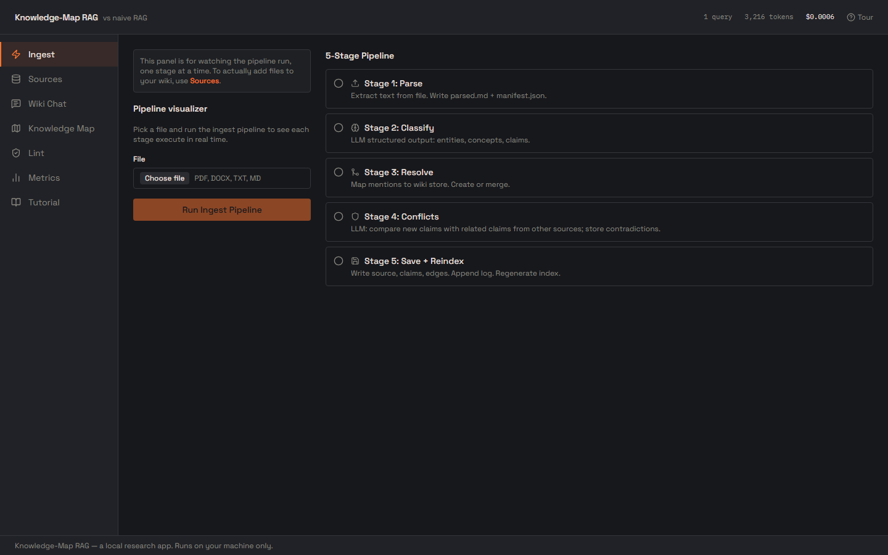

# RAG 2.0 — Karpathy Method

*[English](README.md) · Polski*

[](https://github.com/KonP969/RAG-2.0-Karpathy-Method/actions/workflows/ci.yml)

Lokalna, edukacyjna aplikacja webowa realizująca **Knowledge-Map RAG** — eksperyment
zainspirowany krytyką naiwnego RAG autorstwa Andreja Karpathy'ego. Zamiast tłuc
dokumenty na fragmenty i szukać po wektorach, system przy każdym wgraniu wyciąga ze
źródła strukturalny graf wiedzy i odpowiada na pytania, rozumując nad tym grafem —
pokazując każdy krok.

To projekt badawczo-poznawczy: chodzi o to, żeby pipeline retrievalu był *czytelny*,
a nie żeby był produkcyjnym stackiem RAG.


Zadajesz pytanie, a pipeline przebiega u góry, etap po etapie; odpowiedź poniżej
cytuje dokładnie te twierdzenia (claims), których użył.

| | |
|---|---|
| [](docs/screenshots/knowledge-map.png) | [](docs/screenshots/ingest.png) |
| Graf, z którego budowane są odpowiedzi | 5-etapowy pipeline ingestu, dla każdego źródła |
| [](docs/screenshots/sources.png) | [](docs/screenshots/tutorial.png) |
| Każde wgrane źródło i co z niego wyciągnięto | Wbudowany przewodnik po całym podejściu |

Przy pierwszej wizycie krótki tour przeprowadza przez panele — można go powtórzyć
w dowolnej chwili przyciskiem **Tour** w nagłówku.

## Dlaczego nie naiwny RAG?

Klasyczny RAG (podziel → embeduj → szukaj po wektorach → wstaw do promptu → LLM)
ma problem z:

- **Sprzecznymi faktami** — dwa źródła się nie zgadzają; model dostaje oba i je miesza
- **Pytaniami wieloprzeskokowymi** — odpowiedź wymaga połączenia faktów z kilku dokumentów
- **Aktualizacjami w czasie** — nowsze źródło zaprzecza starszemu, ale stary fragment wygrywa na podobieństwie

Knowledge-Map RAG wyciąga strukturę przy ingeście — encje, koncepty, twierdzenia
(każde z proweniencją) i krawędzie — a potem odpowiada przez 5-etapowy pipeline
rozumowania. Każde zdanie w odpowiedzi da się dociągnąć do konkretnego twierdzenia.

## Architektura

```
  INGEST                            RETRIEVAL
  ──────                            ─────────
  Plik źródłowy                     Pytanie użytkownika
     │                                  │
  1. Parse       (deterministyczny) 1. Intent Parser     (LLM)
  2. Classify    (LLM)              2. Candidate Filter   (leksykalny + semantyczny)
  3. Resolve     (deterministyczny) 3. Selection          (LLM)
  4. Conflict Detect (LLM)          4. Context Assembly
  5. Save + Reindex                 5. Answer Generator   (LLM)
     │                                  │
  wiki_data/ (Markdown + JSONL)     QueryTrace (pełny ślad audytu)
```

Gdy retrieval nie jest pewny, przejmuje **agent fallback** z 10 narzędziami.

**Przechowywanie:** płaskie pliki — strony Markdown plus logi JSONL twierdzeń i
krawędzi. Bez bazy danych, bez usługi vector store. Przenośne, czytelne, diffowalne.

## Panele

| Panel | Co robi |
|---|---|
| **Ingest** | Podgląd, jak plik przechodzi przez 5-etapowy pipeline ingestu. Widok edukacyjny — pliki dodaje się w **Sources**. |
| **Sources** | Każde wgrane źródło z jego tagami, streszczeniem, kluczowymi wnioskami i wygenerowanymi pytaniami. Wgrywanie plików lub import z URL. |
| **Wiki Chat** | Zadajesz pytanie i widzisz pełny ślad retrievalu: intent, ocenionych kandydatów, selekcję LLM, złożony kontekst, cytowaną odpowiedź. |
| **Knowledge Map** | Graf encji i konceptów. Kliknij węzeł, żeby zobaczyć jego twierdzenia, krawędzie i źródła. |
| **Lint** | Kontrola integralności wiki — węzły-sieroty, brak proweniencji, sprzeczności, kolizje aliasów, nieaktualne opisy. Część z auto-poprawką. |
| **Metrics** | Zużycie tokenów w sesji i szacowany koszt. |
| **Tutorial** | Wbudowany przewodnik po architekturze plus interaktywne walkthroughs. |

## Stack

| Warstwa | Technologia |
|---|---|
| Backend | FastAPI · Python 3.9+ |
| Frontend | React 19 · TypeScript · Vite · Tailwind |
| LLM | OpenAI API (domyślnie `gpt-4o-mini` i `text-embedding-3-small`) |
| Przechowywanie | Płaskie pliki — Markdown + JSONL |

## Instalacja

### Wymagania

- Python 3.9+
- Node.js 18+
- Klucz API OpenAI

### 1. Środowisko backendu

```bash
cd backend
python -m venv .venv
source .venv/bin/activate        # Windows: .venv\Scripts\activate
pip install -r requirements.txt
cp .env.example .env             # potem wpisz OPENAI_API_KEY do .env
```

### 2. Zależności frontendu

```bash
cd frontend
npm install
```

### 3. Uruchom oba

```bash
./dev.sh        # macOS / Linux
.\dev.ps1       # Windows (PowerShell)
```

Uruchamia API na `http://localhost:8000` (Swagger pod `/docs`) i aplikację na
`http://localhost:5173`. Vite proxuje `/api` do backendu, więc nie ma nic więcej
do konfiguracji. Ctrl+C zatrzymuje oba.

Żeby uruchomić osobno:

```bash
cd backend  && uvicorn main:app --port 8000
cd frontend && npm run dev
```

> Na części konfiguracji Windows `uvicorn --reload` umiera po pierwszym przeładowaniu
> i serwuje stary kod. Jeśli to trafisz — odpalaj bez `--reload` i restartuj ręcznie.

## Wypróbuj bez wgrywania czegokolwiek

`wiki_data/default` startuje pusty. Żeby zobaczyć aplikację z gotowym grafem, wskaż
dołączony demo-korpus (3 artykuły z Wikipedii o RAG, bazach wektorowych i
word embeddings) — odkomentuj tę linię w `backend/.env`:

```
WIKI_DATA_DIR=wiki_data/.example
```

**Sources**, **Knowledge Map** i **Lint** działają bez klucza API. **Wiki Chat** i
**Ingest** wołają OpenAI, więc dalej potrzebują klucza. Zobacz
`backend/wiki_data/.example/README.md`.

Przykładowe pytania:

- *What problem with large language models does retrieval-augmented generation address?*
- *How do vector databases find similar records?*
- *How are word embeddings related to vector search?*

## Własne źródła

1. W **Sources** wrzuć pliki `.pdf`, `.docx`, `.txt` lub `.md`, albo zaimportuj z URL
2. Poczekaj, aż pipeline ingestu skończy
3. Zadawaj pytania w **Wiki Chat** i czytaj ślad
4. Eksploruj powiązania w **Knowledge Map**
5. Uruchamiaj **Lint** co kilka ingestów, żeby wyłapać sprzeczności i luki

Retrieval działa najlepiej przy konkretnych pytaniach faktograficznych („Kto założył
X?", „Czym A różni się od B?") nad kilkoma źródłami, które się wzajemnie uzupełniają.
Bardzo szerokie prompty („opowiedz mi wszystko") z założenia wypadają słabo.

## Układ projektu

```
backend/
├── api/                    routery FastAPI
├── models/                 modele Pydantic
├── services/
│   ├── ingest_pipeline.py  5-etapowy ingest
│   ├── retrieval/          5-etapowy retrieval + agent fallback
│   ├── lint/               kontrole integralności
│   ├── wiki_store.py       odczyt/zapis wiki_data/
│   └── wiki_index.py       regeneracja 00-Index
├── scripts/                skrypty eval + utrzymaniowe
├── tests/                  ~470 testów jednostkowych + integracyjnych
└── wiki_data/
    ├── default/            twoja baza wiedzy (git-ignored, startuje pusta)
    └── .example/           dołączony demo-korpus

frontend/src/
├── api/client.ts           typowany klient API
└── components/             jeden folder na panel
```

## Struktura danych wiki

```
wiki_data/<nazwa>/
├── raw/                    sparsowane kopie każdego źródła
└── wiki/
    ├── 00-Index/           auto-generowany główny indeks
    ├── 10-Concepts/        jeden plik Markdown na koncept
    ├── 20-Entities/        jeden plik Markdown na encję
    ├── 30-Sources/         strony metadanych źródeł
    ├── claims.jsonl        każde wyciągnięte twierdzenie
    ├── edges.jsonl         każda wyciągnięta relacja
    └── embeddings/         wektory twierdzeń do recallu semantycznego
```

## Testy

```bash
cd backend && python -m pytest -q     # ~470 testów jednostkowych + integracyjnych

cd frontend && npm run test:e2e       # smoke suite Playwright — uruchamia (lub reużywa)
                                      # serwery dev, backend na demo-korpusie, bez klucza API
```

## Licencja

MIT — zobacz [LICENSE](LICENSE). Demo-korpus w `backend/wiki_data/.example/` to
tekst z Wikipedii (CC BY-SA 4.0); zobacz jego `ATTRIBUTION.md`.
